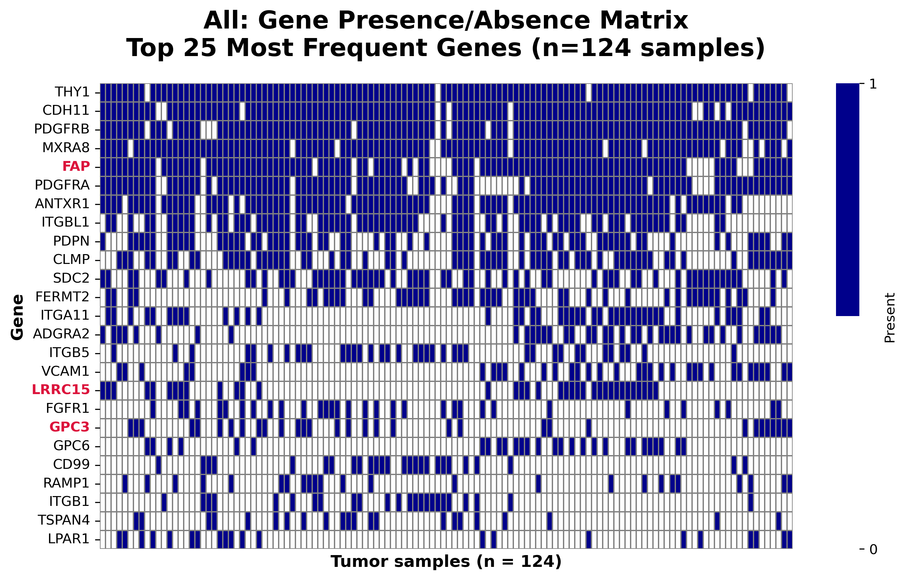
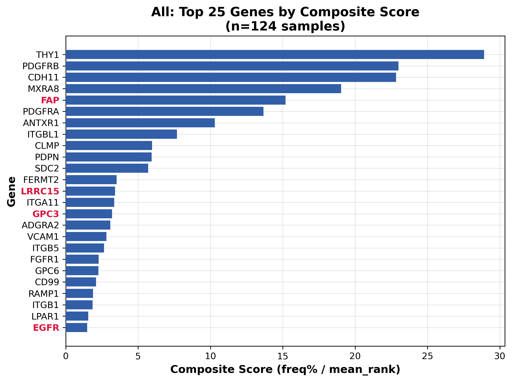
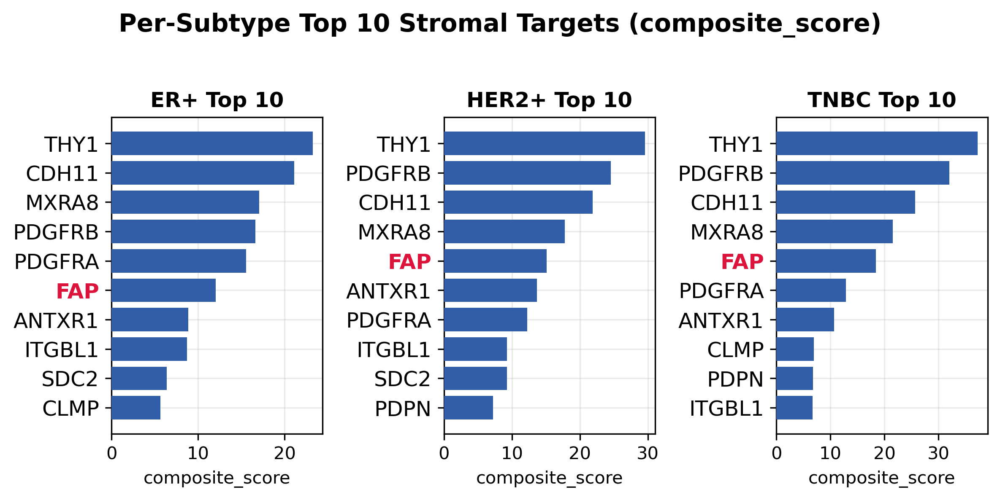
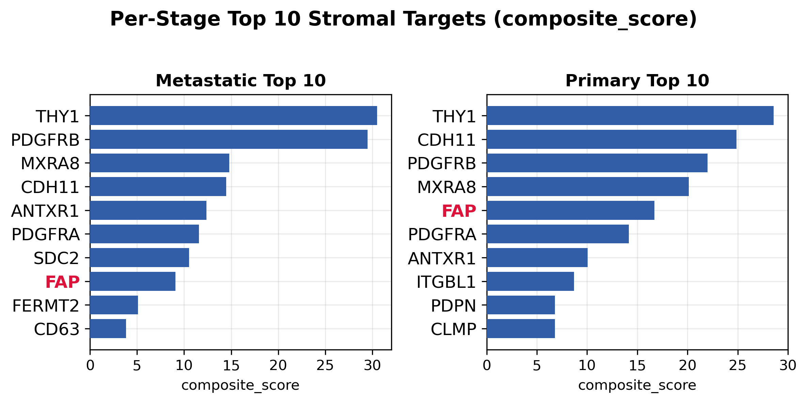
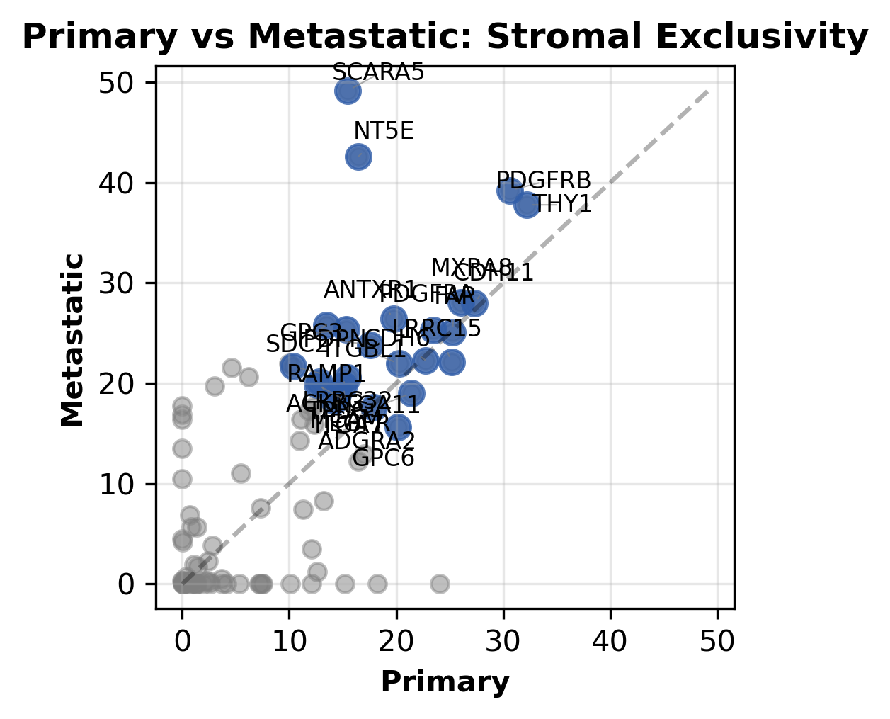
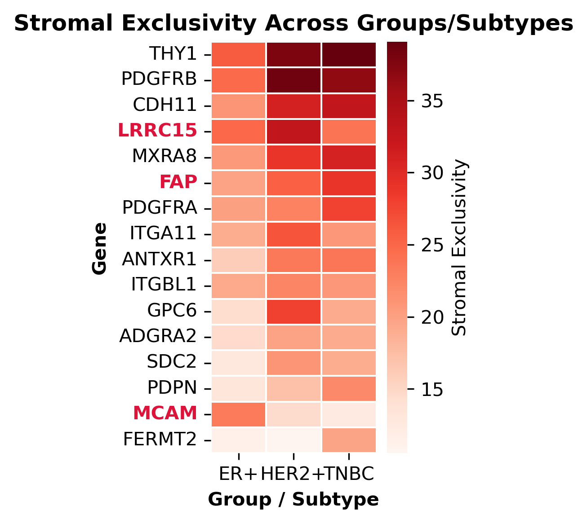
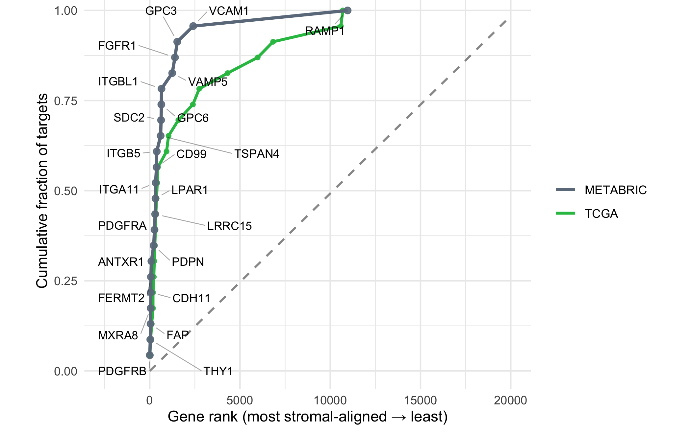
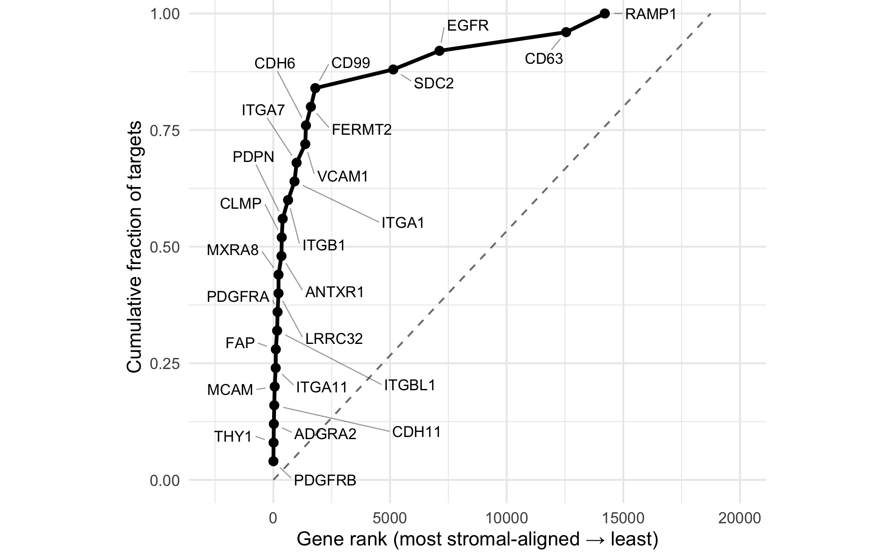

# Stromal Antibody–Drug Conjugate Targets

Systematic identification of stromal-specific antibody–drug conjugate (ADC) targets in breast cancer using single-cell transcriptomics.

ADCs deliver a cytotoxic drug to cells that carry their target protein. The ADCs used in breast cancer today target proteins on cancer cells, which can lose them or express them unevenly. This project looks for targets in the tumor stroma instead: cell-surface proteins made by cancer-associated fibroblasts (CAFs) but not by cancer cells.

## Approach

1. **Single-cell data.** Six public single-cell RNA-seq datasets: 1.08 million cells from 181 samples, covering ER-positive, HER2-positive and triple-negative tumors, primary tumors and metastases. The 124 tumor samples with at least 20 stromal cells enter the pooled analysis.
2. **Surface genes.** Candidates are limited to genes whose proteins Gene Ontology places on the cell surface.
3. **Stromal exclusivity score.** Each candidate gene is scored as
   `log2FC × stromal detection × tumor penalty × detection specificity`,
   which is high for genes expressed in fibroblasts and drops when cancer cells express them.
4. **Composite score.** Each sample's 15 highest-scoring genes are pooled across samples. A gene's composite score is the percentage of samples whose top 15 contains it, divided by its mean rank in those lists.
5. **Bulk validation.** The top 25 genes are tested in TCGA-BRCA, METABRIC and MET500. Each tumor's stromal content is estimated from marker genes, all genes are ranked by how closely they track it, and a permutation test asks whether the candidates sit near the top.

[README_PIPELINE.md](README_PIPELINE.md) gives the exact definitions, thresholds and outputs.

## Results

- **THY1, PDGFRB, CDH11 and MXRA8** rank in the top four of every subtype (ER+, HER2+, TNBC) and disease stage (primary, metastatic).
- **MXRA8** is the leading candidate beyond the established fibroblast markers: it is among the top 15 genes in 89.5% of tumor samples.
- The candidate sets are strongly enriched among the genes most correlated with stromal content in all three bulk cohorts: normalized enrichment score 2.44 in TCGA-BRCA, 2.48 in METABRIC and 2.70 in MET500, with permutation p = 0.0002 in each (the minimum attainable).

In figures 1–4, gene names in red are known ADC targets (EGFR, FAP, GPC3, LRRC15 and MCAM): genes whose protein is the target of an ADC that has entered clinical trials.

**1. Presence of the top 25 genes in each tumor sample.** A filled cell means the gene is among that sample's 15 highest-scoring genes.



**2. Top 25 genes by composite score across all 124 tumor samples.**



**3. Top 10 genes within each subtype (left) and each disease stage (right).**

<p>
  
  
</p>

**4. Stromal exclusivity in primary tumors versus metastases (left; the dashed line marks equal scores) and across subtypes (right).**

<p>
  
  
</p>

**5. Bulk validation.** Cumulative fraction of candidate genes by their rank among all genes, ordered from most to least correlated with stromal content (reference marker genes are left out of the ranking): TCGA-BRCA and METABRIC with the primary-tumor top 25 (left; labels show the METABRIC genes) and MET500 with the metastatic top 25 (right). The dashed line is the expectation for random genes.

<p>
  
  
</p>

## Repository layout

| Path | What it holds |
|---|---|
| `common/` | shared analysis engine: data loading, surface-gene set, scoring, analysis steps, figures |
| `run_pipeline.py` | per-dataset analysis (steps 2–6) for one dataset or all six |
| `composite_scoring.py` | pools the per-sample top-15 lists into the composite score |
| `composite_figures.py` | figures from the composite results |
| `make_original_figures.py` | draws figures 1–4 with the original plotting scripts |
| `GSE*/` | each dataset's download, preprocessing and run scripts |
| `ORIG_GFA/` | the original gene-frequency plotting scripts that `make_original_figures.py` uses |
| `original_plots/` | the original per-dataset plotting scripts that `make_original_figures.py` runs |
| `TCGA_Data/`, `Metabric/`, `MET500/` | bulk-validation R scripts |
| `PRIMARY/` | overlays the TCGA-BRCA and METABRIC results (figure 5, left) |
| `figures/` | the figures above |

## Data

The data are not in this repository (about 65 GB).

**Single-cell datasets** come from the Gene Expression Omnibus. Each is converted to one AnnData file at the path below, and `common/config.py` records which annotation marks fibroblasts and cancer cells in each. Most dataset folders include the scripts used to download and convert the raw files.

| Dataset | Source | Samples | File the code reads |
|---|---|---|---|
| [GSE161529](https://www.ncbi.nlm.nih.gov/geo/query/acc.cgi?acc=GSE161529) | Pal et al., 2021 | 69: normal, BRCA1 preneoplastic, ER+, PR+, HER2+ and TNBC primaries, involved lymph nodes | `GSE161529/data/dataset.h5ad` |
| [GSE167036](https://www.ncbi.nlm.nih.gov/geo/query/acc.cgi?acc=GSE167036) | Liu et al., 2022 | 16: primary tumor and lymph-node metastasis from 8 patients | `GSE167036/data/dataset.h5ad` |
| [GSE176078](https://www.ncbi.nlm.nih.gov/geo/query/acc.cgi?acc=GSE176078) | Wu et al., 2021 | 26 primary tumors (ER+, HER2+, TNBC) | `GSE176078/data/dataset.h5ad` |
| [GSE180286](https://www.ncbi.nlm.nih.gov/geo/query/acc.cgi?acc=GSE180286) | Xu et al., 2021 | 15: primary tumor and 2 lymph nodes from 5 patients | `GSE180286/data/dataset.h5ad` |
| [GSE305078](https://www.ncbi.nlm.nih.gov/geo/query/acc.cgi?acc=GSE305078) | Fu et al., 2025 | 32 TNBC biopsies (26 early-stage, 6 advanced) | `GSE305078/data/GSE305078_dataset.h5ad` |
| [GSE306201](https://www.ncbi.nlm.nih.gov/geo/query/acc.cgi?acc=GSE306201) | Ozmen et al., 2025 | 23 ER+: 12 primary tumors, 11 distant metastases | `GSE306201/data/dataset.h5ad` |

`GSE161529/fix_metadata_gse161529.py` also reads that dataset's GEO series matrix (`GSE161529/GSE161529_series_matrix.txt`).

**Bulk cohorts.** The R scripts download TCGA-BRCA (RNA-seq, 1,097 primary tumors, UCSC Xena) and METABRIC (microarray, 1,980 primary tumors, cBioPortal DataHub) themselves. For MET500 (RNA-seq, 159 profiles from 92 metastatic breast cancer biopsies, UCSC Xena), put `MET500_geneExpression_M.mx.log2.zscore.txt`, `MET500_metadata.txt` and `gene_mapping.txt` (Ensembl ID to gene symbol) in `MET500/` first.

## Running

Set up Python 3.13 with conda:

```bash
conda create -n stromal-adc python=3.13
conda activate stromal-adc
pip install -r requirements.txt
```

Then, from the repository root:

```bash
python run_pipeline.py all          # per-dataset analysis for all six datasets (or name one, e.g. GSE161529)
python composite_scoring.py         # composite scores, written to composite/
python composite_figures.py         # composite figures, written to composite/figures/
python make_original_figures.py     # figures 1-4 (composite/original_style/) and per-dataset figures
```

On its first run the engine downloads the Gene Ontology human annotation file (`goa_human.gaf.gz`) into `common/cache/` to build the surface-gene set. GO annotations are updated regularly, so a new download can shift that set slightly.

**Bulk validation (R).** Run each script from inside its folder with the candidate gene list as its argument; the scripts install the CRAN packages they need. TCGA-BRCA and METABRIC use the primary-tumor top 25, MET500 the metastatic top 25:

```bash
(cd TCGA_Data && Rscript tcga_brca_stromal_enrichment.R ../composite/Primary/top25_composite.txt)
(cd Metabric && Rscript metabric_brca_stromal_enrichment.R ../composite/Primary/top25_composite.txt)
(cd MET500 && Rscript met500_brca_stromal_enrichment.R ../composite/Metastatic/top25_composite.txt)
(cd PRIMARY && Rscript ecdf_overlay_metabric_tcga.R ../composite/Primary/top25_composite.txt)
```

Run without arguments (for example from RStudio), each script asks for the gene list instead. The last command overlays the TCGA-BRCA and METABRIC results (figure 5, left). The `*_deconv.R` scripts are earlier versions of the same analysis.

## More detail

[README_PIPELINE.md](README_PIPELINE.md) documents the analysis engine: what each run writes, the definitions of stromal and tumor cells, and the scoring formula.
